<p align="center">
  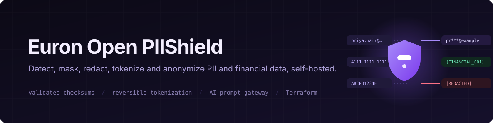
</p>

<p align="center">
  
  <a href="LICENSE"></a>
  
  
  
  
  
  
</p>

<p align="center">
  <a href="https://github.com/euron-sde-team/euron-open-piishield/stargazers"></a>
  <a href="https://github.com/euron-sde-team/euron-open-piishield/fork"></a>
  <a href="https://github.com/euron-sde-team/euron-open-piishield/watchers"></a>
  <br>
  <a href="https://github.com/euron-sde-team/euron-open-piishield/issues"></a>
  <a href="https://github.com/euron-sde-team/euron-open-piishield/pulls"></a>
  <a href="https://github.com/euron-sde-team/euron-open-piishield/commits/main"></a>
  
  <br>
  <a href="#built-by-the-team-behind-euron"></a>
</p>

<p align="center">
  <b><a href="#-quickstart">Quickstart</a></b> ·
  <b><a href="#️-architecture">Architecture</a></b> ·
  <b><a href="#-explore-the-repository">Explore the repo</a></b> ·
  <b><a href="docs/api/openapi.yaml">API reference</a></b> ·
  <b><a href="#️-deploy-to-aws">Deploy</a></b> ·
  <b><a href="docs/architecture/security.md">Security</a></b> ·
  <b><a href="#-documentation">Docs</a></b>
</p>

**Euron Open PIIShield** is an open-source, MIT-licensed PII and financial-data detection,
masking, redaction, tokenization and anonymization platform, part of the open-source
initiative of **ENGAGESPHERE TECHNOLOGY PRIVATE LIMITED**. Send it text, a JSON payload, a
document or an AI prompt, and it returns the same content with every sensitive value
found, classified and protected by the method you choose, with a confidence score on
every finding and an audit trail of what happened, never the original value.

It exists so that pasting a real customer's card number, PAN or Aadhaar into an AI tool,
a log line, or a staging database seed stops being the default, because redacting it by
hand is tedious and detecting it by hand is unreliable:

- One API for every surface: text, JSON, PDF/DOCX/XLSX/CSV documents, and an AI
  prompt/response gateway, instead of a detection library you wire up yourself.
- Validated, checksummed detectors (Luhn for cards, Verhoeff for Aadhaar, ISO 7064 mod 97
  for IBAN, the PAN entity-character rule), so a random digit string is never reported as
  a card or government ID just because it has the right length.
- Reversible tokenization with the mapping held only in an encrypted vault, gated by its
  own permission, so an authorized caller can restore the original value after an AI call
  without the AI provider ever seeing it.

The whole stack runs on a laptop against a local AWS emulator, and the same Terraform that
provisions it validates cleanly for a real AWS deployment.

<p align="center">
  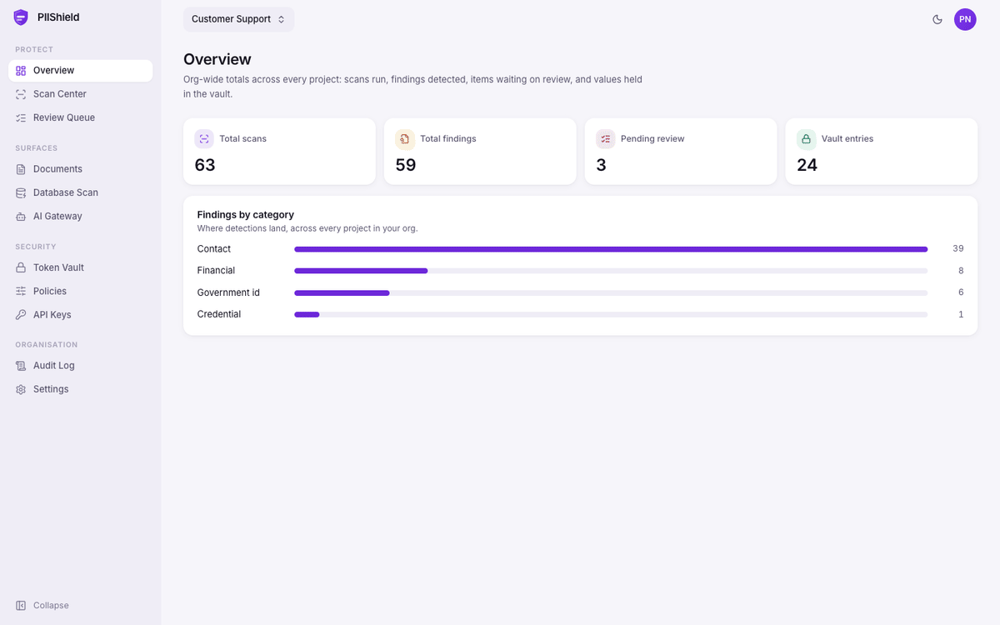
</p>

> [!NOTE]
> Everything in the tour ran for real: Docker Compose on a laptop, with SES emulated
> locally (Mailpit) and provisioned by the same Terraform modules that build production.
> `make up && make demo` reproduces it. The same Terraform also provisions a KMS key and
> alias on the local emulator, for `make tf-aws-on-floci` and a future KMS-backed vault
> key to target; 0.1.0's running app does not read it yet (`KEY_MODE` stays `local`), and
> has no S3 or Secrets Manager integration at all, see
> [docs/guides/local-with-aws.md](docs/guides/local-with-aws.md).

<h3 align="center">Built by the team behind Euron</h3>

<p align="center">Euron Open PIIShield comes from the people who build these platforms. If you like how this repository is built, come and see what we build with it.</p>

<p align="center">
  <a href="https://euron.one"><picture><source media="(prefers-color-scheme: dark)" srcset="docs/assets/brand/euron-dark.svg"></picture></a>
  <a href="https://euronsystems.com"><picture><source media="(prefers-color-scheme: dark)" srcset="docs/assets/brand/euron-systems-dark.svg"></picture></a>
  <a href="https://alphaeuron.com"><picture><source media="(prefers-color-scheme: dark)" srcset="docs/assets/brand/alpha-euron-dark.svg"></picture></a>
</p>

<p align="center">
  <a href="https://www.instagram.com/euron_official"></a>
  <a href="https://www.linkedin.com/company/euronone/posts/"></a>
  <a href="https://x.com/euron712"></a>
  <a href="https://www.youtube.com/@Euron-official"></a>
  <a href="https://whatsapp.com/channel/0029VaeeJwq9RZAfPW9P2l07"></a>
</p>

---

## 📚 Table of contents

- [Why Euron Open PIIShield](#-why-euron-open-piishield)
- [At a glance](#-at-a-glance)
- [Screenshots](#️-screenshots)
- [Features](#-features)
- [Architecture](#️-architecture)
- [Tech stack](#-tech-stack)
- [Prerequisites](#-prerequisites)
- [Quickstart](#-quickstart)
- [Explore the repository](#-explore-the-repository)
- [API](#-api)
- [Configuration](#️-configuration)
- [Deploy to AWS](#️-deploy-to-aws)
- [Security model](#-security-model)
- [Testing](#-testing)
- [Documentation](#-documentation)
- [Roadmap](#️-roadmap)
- [FAQ](#-faq)
- [Contributing, security and license](#-contributing-security-and-license)

---

## 💡 Why Euron Open PIIShield

Comparable tools fall short in one of two ways: Microsoft Presidio is a detection
library, not a platform (no API server, no masking-method choice per field, no reversible
vault, no AI-gateway framing); AWS Comprehend PII and Macie are cloud-only and not
self-hostable; commercial DLP suites are closed source and not developer-first.

- **One API for every surface.** Text, JSON, documents and an AI prompt/response gateway
  all go through the same detection, policy and protection pipeline, not four different
  integrations.
- **Checksums, not guesses.** Every card, Aadhaar, IBAN, PAN and US SSN recognizer
  validates a real checksum before reporting a finding; a value that fails it is dropped
  entirely, never reported at low confidence.
- **Reversible, but never exposed.** Tokenization keeps the original value only in an
  encrypted vault, and detokenizing it requires a permission separate from any role or API
  key scope, never implied by `owner`, `admin`, or a write-scoped key.
- **Self-hosted, with a real path to AWS.** `make up` runs the whole stack, Postgres
  through the dashboard, against a local emulator; the same Terraform validates for
  `aws-dev` and `aws-prod`.

## 📊 At a glance

| | |
| --- | --- |
| **Detection categories** | `contact`, `credential`, `financial`, `government_id`, `personal`, each with checksum-validated recognizers where a real checksum exists |
| **Protection methods** | Full mask, partial mask, redact, reversible tokenize |
| **Surfaces** | Text, JSON (recursive leaf scanning), PDF/DOCX/XLSX/CSV documents, an AI prompt/response gateway, a read-only database column scan |
| **Isolation** | `org_id` structural scoping on every table; vault access is its own grant, separate from role and API key scope |
| **Tests** | 110 backend tests (86% coverage), 2/2 test-matrix combinations, 53+5 Python SDK tests, 27+5 Node SDK tests, 40 web unit tests, 14 e2e tests (run twice clean), 52 browser QA page views with 0 problems |
| **Infrastructure** | 10 Terraform modules, 3 environments (local-floci, aws-dev, aws-prod), checkov 311/311 passed, a full 152-resource apply/re-plan/destroy against a throwaway Floci with zero adds or replacements on re-plan |
| **License** | MIT |

## 🖼️ Screenshots

<table>
  <tr>
    <td width="50%">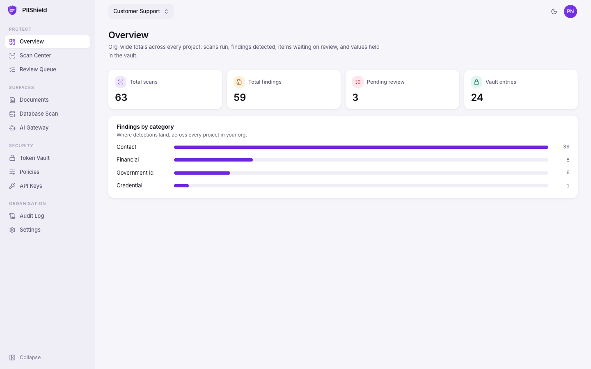<br><sub><b>Overview.</b> Org-wide totals and findings by category, across every project.</sub></td>
    <td width="50%">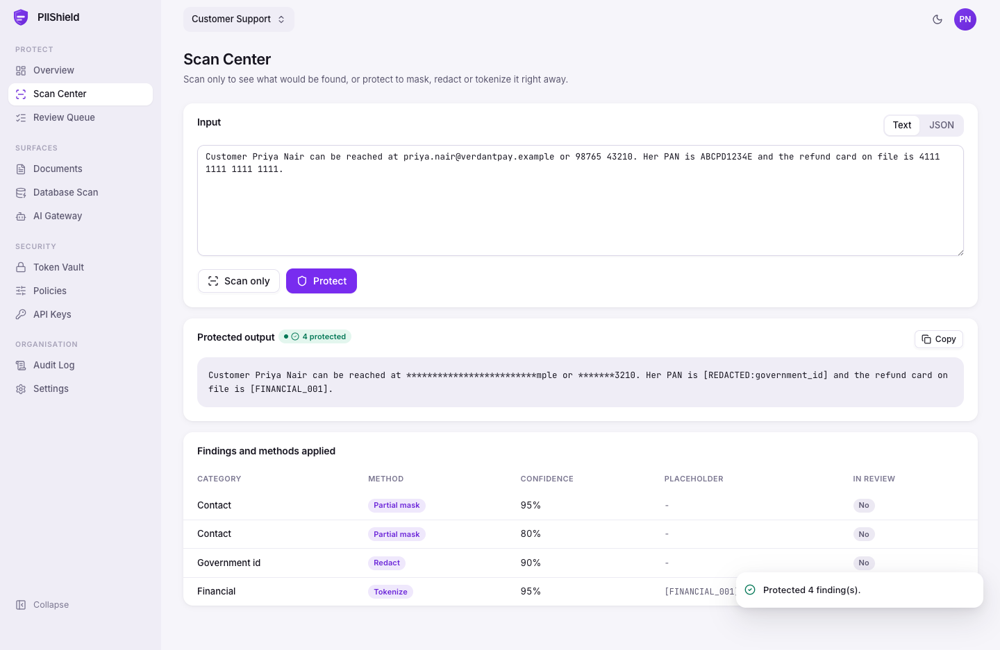<br><sub><b>Scan Center.</b> A real scan: four findings, each with its own protection method, and the protected output.</sub></td>
  </tr>
  <tr>
    <td>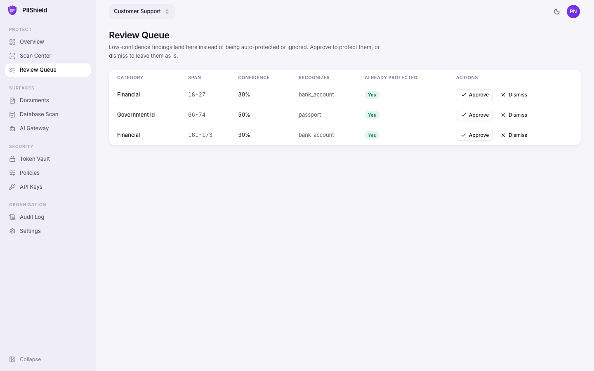<br><sub><b>Review Queue.</b> Low-confidence findings pending a human decision.</sub></td>
    <td>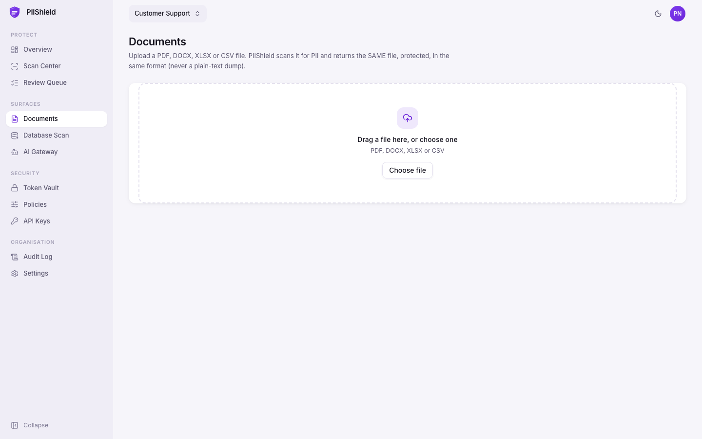<br><sub><b>Documents.</b> Protect a PDF, DOCX, XLSX or CSV and get the same file format back.</sub></td>
  </tr>
  <tr>
    <td>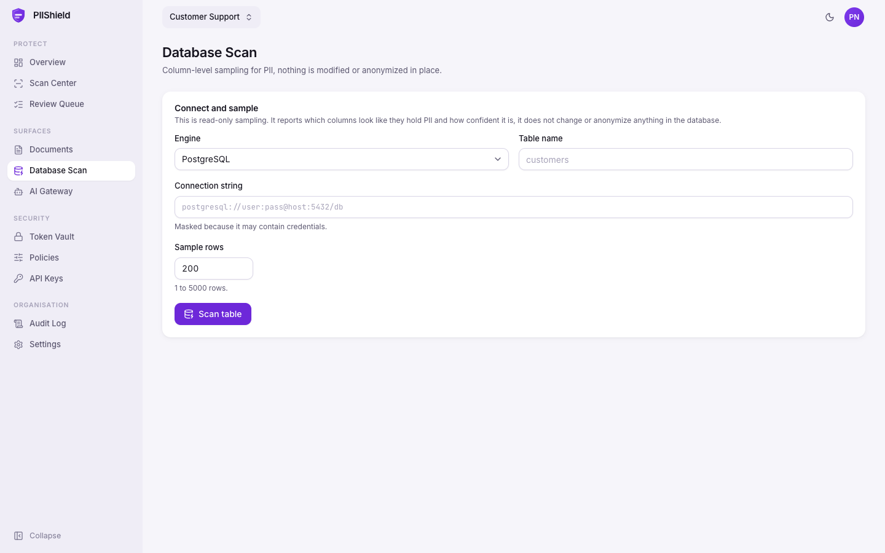<br><sub><b>Database Scan.</b> A read-only, column-level scan of a connected database.</sub></td>
    <td>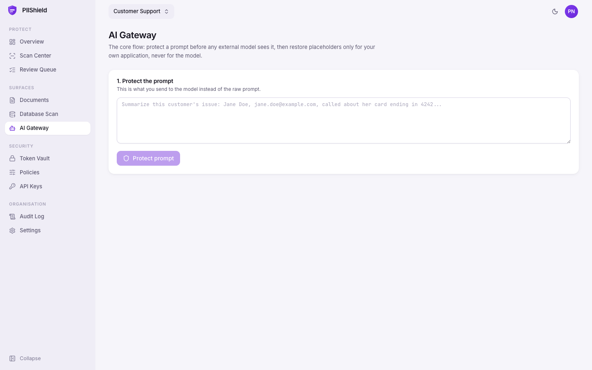<br><sub><b>AI Gateway.</b> Protect a prompt before it reaches a model, restore it after.</sub></td>
  </tr>
  <tr>
    <td>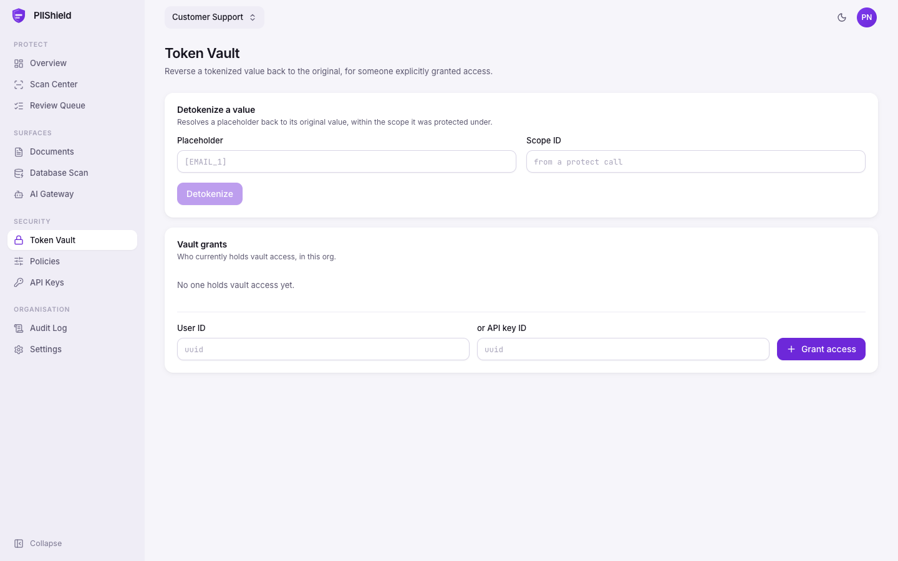<br><sub><b>Token Vault.</b> Resolve a placeholder back to its original value, if you hold vault access.</sub></td>
    <td>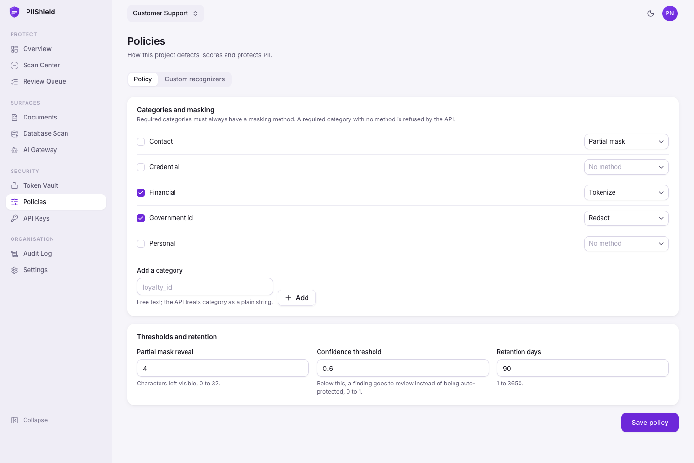<br><sub><b>Policies.</b> Required categories, masking method per category, confidence threshold.</sub></td>
  </tr>
  <tr>
    <td>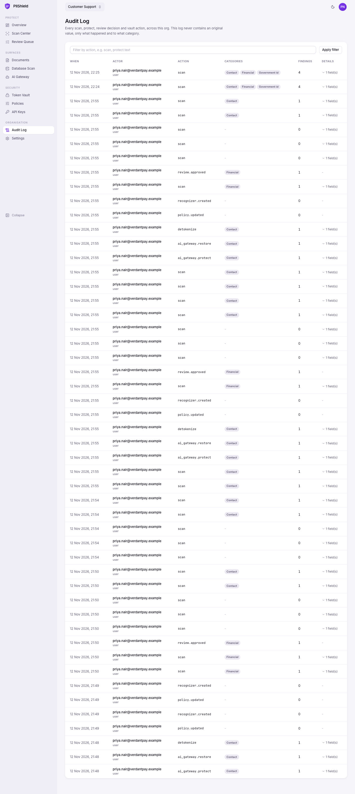<br><sub><b>Audit Log.</b> Every scan, protect and vault action, never an original value.</sub></td>
    <td>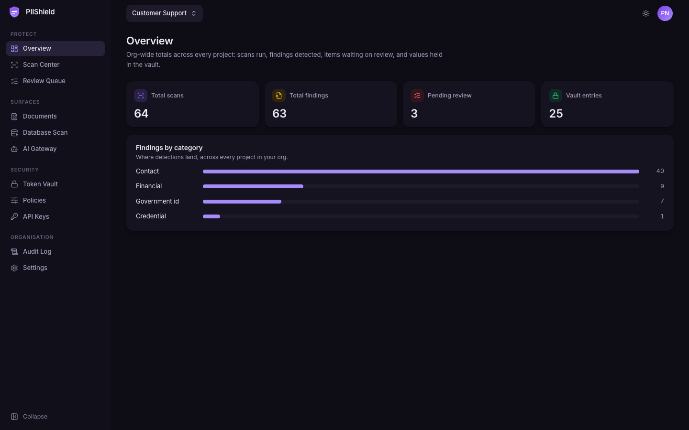<br><sub><b>Dark mode.</b> Every page, dark and light.</sub></td>
  </tr>
</table>

<p align="center">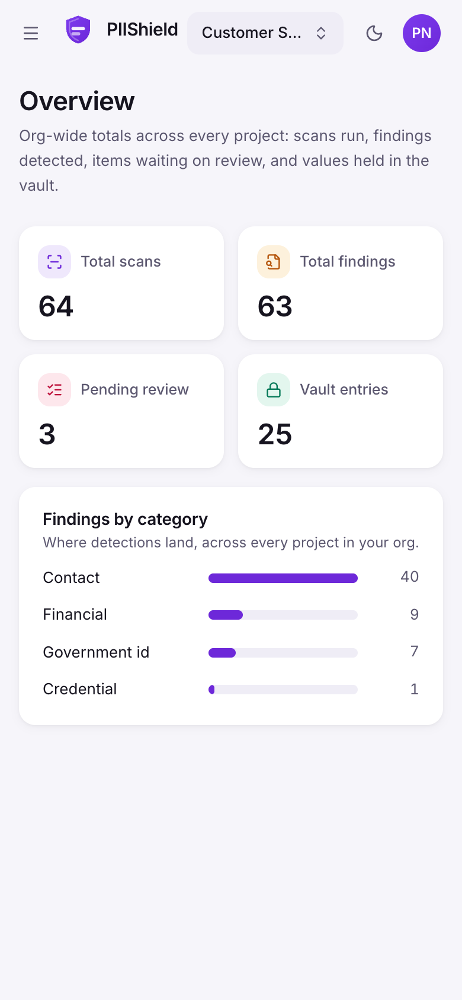<br><sub>Responsive down to phone width.</sub></p>

## ✨ Features

| Area | What you get |
| --- | --- |
| **Detection** | Regex recognizers with real checksum validation for person name, email, phone (Indian and US/international), address, date of birth, PAN, Aadhaar, passport, driving licence, credit/debit card, bank account, IFSC, SWIFT/BIC, UPI ID, IBAN, US SSN, and generic credential patterns (API key, JWT, password assignment), plus a custom pattern per project. Every finding carries category, exact span, confidence and checksum result |
| **Protection** | Full masking, partial masking (configurable reveal count), redaction, and reversible tokenization with scope-consistent placeholders (the same value in one scope always yields the same placeholder) |
| **JSON** | Recursive leaf-string scanning and protection that preserves the exact original structure |
| **Documents** | PDF (text layer), DOCX, XLSX/CSV scanning and protected re-export in the same file format, with a per-page/sheet findings breakdown |
| **AI privacy gateway** | `protect` before a prompt reaches a model, `restore` after, scoped to a `scope_id` never embedded in the prompt itself |
| **Database scan** | A read-only, column-level scan against a Postgres, MySQL or SQLite connection; samples rows, reports which columns look like they hold PII, never writes back |
| **Vault** | Envelope-encrypted tokenized values (AES-256-GCM, per-record context binding). Ships `key_mode=local` in 0.1.0; `key_mode=kms` is a deliberate, documented roadmap item behind the same `Sealer` protocol, not a current feature |
| **Policies** | Per-project required categories, masking method per category, confidence threshold, retention period |
| **Multi-tenant** | `org_id` structural scoping; roles owner, admin, viewer, plus a vault-access grant that is always separate from role |
| **Dashboard** | Sign in, Overview, Scan Center, Review Queue, Documents, Database Scan, AI Gateway, Token Vault, Policies, Audit Log, API Keys, Settings. Dark and light |
| **Admin API** | Everything the dashboard does, under `/api/v1`, OpenAPI documented |
| **SDKs** | Python and Node, both wire-compatible with the raw REST API, asserted byte-identical by a shared test fixture |
| **CLI** (`piishield`) | `serve`, `migrate`, `revision`, `openapi`, `create-admin`, `seed-demo`: the same entry point serves the API and runs admin/ops tasks, no separate scanning tool |

## 🏗️ Architecture

<p align="center">
  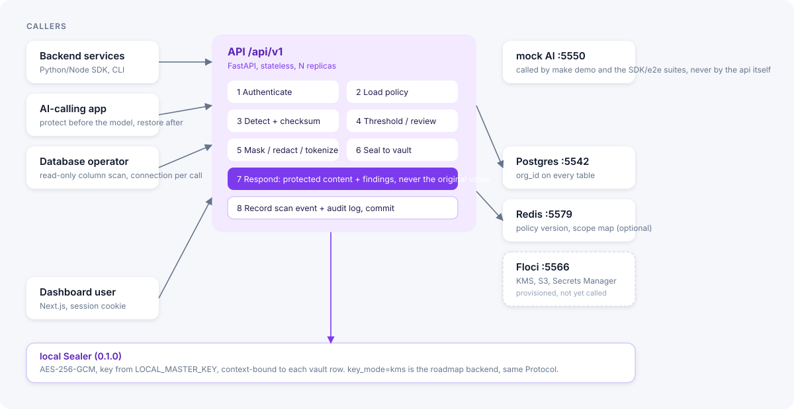
</p>

The API is packaged by domain (`auth`, `orgs`, `projects`, `detectors`, `protection`,
`vault`, `policies`, `documents`, `database_scan`, `ai_gateway`, `review`, `audit`), each
following router to service to repository to models, the same layering throughout. A scan
or protect call authenticates, loads the project's policy from a bounded-staleness cache,
runs every enabled recognizer with checksum validation, applies the requested protection
method, and records a scan event and audit entry, never the original value. See
[HLD.md](docs/architecture/HLD.md) and [LLD.md](docs/architecture/LLD.md) for the full
design, and [data-model.md](docs/architecture/data-model.md) for the schema.

## 🧰 Tech stack

| Layer | Choice |
| --- | --- |
| Backend | Python 3.12, FastAPI, Pydantic v2, SQLAlchemy 2.0 async, Alembic migrations |
| Database | PostgreSQL 16 |
| Cache / KV | Redis 7, with an in-process fallback when Redis is not configured |
| Frontend | Next.js 15 App Router, React 19, TypeScript strict, Tailwind, TanStack Query |
| SDKs | Python (`euron-piishield`), Node/TypeScript |
| Infrastructure as code | Terraform, modules for network, database, cache, storage, KMS, secrets, ECR, service, observability |
| Local AWS | Floci (MIT), provisioned by the same Terraform modules as production |
| Tests | pytest, Vitest, Playwright, Puppeteer browser QA |

## 📋 Prerequisites

| Tool | Version | Used for |
| --- | --- | --- |
| [Docker](https://docs.docker.com/get-docker/) with Compose v2 | 24+ | The local stack |
| [uv](https://docs.astral.sh/uv/) | latest | Running the API and SDK tests outside Docker |
| [Node.js](https://nodejs.org/) | 22 LTS | Building and testing the web app, SDKs and e2e outside Docker |
| [pnpm](https://pnpm.io/) | 9 (`corepack enable`) | The web app, SDK and e2e package manager |
| [Terraform](https://developer.hashicorp.com/terraform/install) | 1.16+ | Only for deploying to AWS (local runs use a pinned container) |

## 🚀 Quickstart

```bash
git clone https://github.com/euron-sde-team/euron-open-piishield.git
cd euron-open-piishield

make env     # generate deploy/compose/.env with random local secrets
make up      # Postgres, Redis, Floci (Terraform-provisioned), mock AI, api, web
make demo    # a seeded organisation: projects, policies, scans, findings, vault entries
```

| Open | As |
| --- | --- |
| http://localhost:5510 | `priya.nair@verdantpay.example` / `Demo-Owner-Pass-1` |
| http://localhost:5530/docs | The API's interactive docs |
| http://localhost:5525 | Every email the stack sends (Mailpit) |

`make down` stops everything and deletes the local data.

[Full local guide](docs/guides/quickstart-local.md) ·
[Run locally against real AWS](docs/guides/local-with-aws.md) ·
[Troubleshooting](docs/guides/troubleshooting.md)

## 🧭 Explore the repository

```text
euron-open-piishield/
├── apps/
│   ├── api/                 FastAPI service
│   │   └── src/piishield/
│   │       ├── core/             config, db, kv, sealing, security, errors
│   │       ├── auth/              sessions, API keys, role and vault-access gates
│   │       ├── orgs/               organisations, users, roles
│   │       ├── projects/           the scoping boundary for keys, policies, vault entries
│   │       ├── detectors/          recognizers, checksums, scan_text
│   │       ├── protection/         full mask, partial mask, redact, tokenize
│   │       ├── vault/               the encrypted mapping store, detokenization
│   │       ├── policies/            per-project required categories and masking methods
│   │       ├── documents/           PDF/DOCX/XLSX/CSV dispatch and per-leaf reuse
│   │       ├── database_scan/       read-only column scan
│   │       ├── ai_gateway/          protect/restore for an AI prompt/response
│   │       ├── review/              the low-confidence queue
│   │       └── audit/               the append-only log
│   └── web/                 Next.js dashboard
├── sdks/
│   ├── python/               euron-piishield
│   └── node/                  @euron/piishield
├── e2e/                      Playwright suites
├── infra/terraform/          modules/ + envs/{local-floci,aws-dev,aws-prod}
├── deploy/compose/           compose.yaml, compose.floci.yaml, compose.aws.yaml
├── docs/                     architecture, ADRs, guides, OpenAPI
└── scripts/                  test matrix, sanitization check, Puppeteer QA
```

**Where to start reading:**

| To understand | Read |
| --- | --- |
| How a scan becomes protected output | `detectors/recognizers.py` `scan_text`, then `protection/service.py` |
| How tokenization stays consistent within a scope | `vault/service.py tokenize`, then [LLD.md](docs/architecture/LLD.md) |
| How the vault is encrypted | `core/sealing.py`, then [ADR-0001](docs/architecture/adr/0001-envelope-encryption-local-key-only.md) |
| How vault access is gated | `auth/dependencies.py`, then [security.md](docs/architecture/security.md) |
| How the AI gateway's trust boundary works | `ai_gateway/service.py`, then [threat-model.md](docs/architecture/threat-model.md) |
| How tenants are isolated | any `repository.py`'s use of `OrgScope`, then [data-model.md](docs/architecture/data-model.md) |

The [walkthrough](docs/guides/walkthrough.md) tours the dashboard page by page.

## 🔌 API

The [OpenAPI reference](docs/api/openapi.yaml) is exported directly from the running
FastAPI app (`make openapi`), so it cannot drift from the code.

```bash
curl -s http://localhost:5530/api/v1/protect/text \
  -H "Authorization: Bearer pii_<prefix>_<secret>" \
  -H "Content-Type: application/json" \
  -d '{"project_id": "<id>", "text": "Contact priya.nair@verdantpay.example or 98765 43210."}'
```

## ⚙️ Configuration

Every setting comes from the environment and is validated once at boot. Production
refuses to boot unless the session, API key and vault master key secrets are long and
not a development default, CORS names its origins, and cookies are marked secure. See the
[configuration reference](docs/guides/configuration.md) for every field, including which
ones (`storage`, `aws_secrets_enabled`, `key_mode=kms`) are accepted but not yet backed by
real behavior in 0.1.0.

## ☁️ Deploy to AWS

```bash
cd infra/terraform/envs/aws-dev
cp terraform.tfvars.example terraform.tfvars   # set region, domain, instance sizes
make aws-deploy ENV=aws-dev TAG=0.1.0           # registries, images, infra, migrations, rollout
```

Nothing is ever applied to a real AWS account by this repository's own verification:
`aws-dev` and `aws-prod` are validated, linted, security-scanned with checkov, and
exercised end to end (apply, re-plan, destroy) against a throwaway Floci emulator. See
[deploy to AWS](docs/guides/deploy-aws.md), including a real, documented gap between the
Terraform (which sets `KEY_MODE=kms`) and 0.1.0's app code (which does not implement it
yet).

## 🔐 Security model

- **Envelope encryption.** Every tokenized value is AES-256-GCM encrypted under a
  per-record context bound to its own vault row, so a ciphertext copied between rows
  fails to decrypt. 0.1.0 ships the `local` key backend; `key_mode=kms` is an explicit,
  deliberate scope limit (`NotImplementedError` at boot, never a silent fallback), not a
  bug. See [ADR-0001](docs/architecture/adr/0001-envelope-encryption-local-key-only.md).
- **Vault access is its own permission**, never implied by role or API key scope. An
  owner grants it explicitly, separate from `admin` or a write-scoped key.
- **Structural tenant isolation.** Every table carries `org_id`; a cross-organisation
  lookup returns 404, never 403, never a hint that the row exists.
- **The audit log cannot carry a raw value by construction**: its write path has no
  parameter a value could be passed through, and a sanitizer drops any detail key that
  looks like it could hold one.

Full design in [security.md](docs/architecture/security.md) and
[threat-model.md](docs/architecture/threat-model.md).

## 🧪 Testing

| Suite | What it proves | Run |
| --- | --- | --- |
| Unit (110, 86% coverage) | Recognizers, checksums, protection methods, policy cache, vault scope consistency, Prometheus metrics | `make test` |
| Integration | The real API against Postgres, Redis and the mock AI: every endpoint, RBAC, tenant isolation, the vault-access gate | `make test-integration` |
| Test matrix (2/2) | The integration suite under `kv=redis` and `kv=memory` | `make test-matrix` |
| Python SDK (53 + 5 live) | Unit plus live integration against a running API | `cd sdks/python && uv run pytest` |
| Node SDK (27 + 5 live) | Unit plus live integration against a running API | `cd sdks/node && pnpm test` |
| Web unit (40) | Dashboard logic | `make test` |
| Browser (14 e2e, run twice clean) | Sign in, scan, protect, detokenize, review, AI gateway protect/restore | `make e2e` |
| Browser QA (52 page views, 0 problems) | Every page, light and dark, desktop and phone | `make qa` |
| Infrastructure | `terraform validate` (3 environments), tflint, checkov (311/311), a full `aws-dev` apply/re-plan/destroy against a throwaway Floci (152 resources, zero adds or replacements on re-plan) | `make tf-validate tf-lint tf-security tf-aws-on-floci` |

[Testing guide](docs/guides/testing.md)

## 📖 Documentation

| Architecture | Guides |
| --- | --- |
| [High-level design](docs/architecture/HLD.md) | [Quickstart (local)](docs/guides/quickstart-local.md) |
| [Low-level design](docs/architecture/LLD.md) | [Local against real AWS](docs/guides/local-with-aws.md) |
| [Data model](docs/architecture/data-model.md) | [Deploy to AWS](docs/guides/deploy-aws.md) |
| [Security](docs/architecture/security.md) | [Configuration reference](docs/guides/configuration.md) |
| [Threat model](docs/architecture/threat-model.md) | [Operations runbook](docs/guides/operations.md) |
| [Decision records](docs/architecture/adr/) | [Testing](docs/guides/testing.md) · [Troubleshooting](docs/guides/troubleshooting.md) |
| [API reference (OpenAPI)](docs/api/openapi.yaml) | [Walkthrough](docs/guides/walkthrough.md) |

## 🗺️ Roadmap

- Image OCR and scanned-document redaction
- Full NER-based name and address detection
- A KMS-backed `Sealer` behind the existing protocol (`key_mode=kms`)
- Database write-back anonymization and bulk sanitization
- GitHub/CI-CD scanning integrations
- Format-preserving masking and synthetic data generation
- Consent tracking
- SSO/OIDC for the dashboard
- A managed hosting offering

Have an idea? [Open a feature request](https://github.com/euron-sde-team/euron-open-piishield/issues/new/choose).

## ❓ FAQ

<details>
<summary><b>Do I need an AWS account to try it?</b></summary>

No. `make up` runs KMS, S3, Secrets Manager and SES on a local emulator, provisioned by
the same Terraform modules as production. Mail lands in Mailpit.
</details>

<details>
<summary><b>Can a write-scoped API key read the vault?</b></summary>

No. Vault access is a separate permission, granted explicitly through
`POST /api/v1/vault/grants` by an owner, never implied by a role or an API key's scope.
See [security.md](docs/architecture/security.md).
</details>

<details>
<summary><b>Does the audit log ever contain an original value?</b></summary>

No. The write path (`audit.service.record`) has no parameter a raw value could be passed
through, and a sanitizer drops any detail key that looks like it could hold one. It is
capped at 200 entries per request in 0.1.0, with no pagination past that cap yet, a
documented limitation, not a confidentiality issue.
</details>

<details>
<summary><b>Is tokenization reversible?</b></summary>

Yes, by design: a tokenized value's original is held only in the encrypted vault, and an
authorized caller can resolve a placeholder back to it. The same value within one scope
always yields the same placeholder.
</details>

<details>
<summary><b>Does the AI gateway send my data anywhere?</b></summary>

No external model call is made by PIIShield itself. The gateway protects a prompt before
your own application sends it to a model, and restores placeholders in the model's
response for your application only, after the fact.
</details>

<details>
<summary><b>Is KMS-backed key sealing supported?</b></summary>

Not in 0.1.0. `key_mode=kms` raises `NotImplementedError` at boot on purpose, rather than
silently falling back to a weaker key backend. See
[ADR-0001](docs/architecture/adr/0001-envelope-encryption-local-key-only.md).
</details>

## 🤝 Contributing, security and license

Contributions are welcome: read [CONTRIBUTING.md](CONTRIBUTING.md) and the
[code of conduct](CODE_OF_CONDUCT.md). Report security issues privately as described in
[SECURITY.md](SECURITY.md).

Released under the [MIT License](LICENSE). Copyright (c) 2026 ENGAGESPHERE TECHNOLOGY
PRIVATE LIMITED and the Euron Open PIIShield contributors.

<p align="center">
  If Euron Open PIIShield saves you time, <b><a href="https://github.com/euron-sde-team/euron-open-piishield/stargazers">⭐ star the repository</a></b>.
</p>
