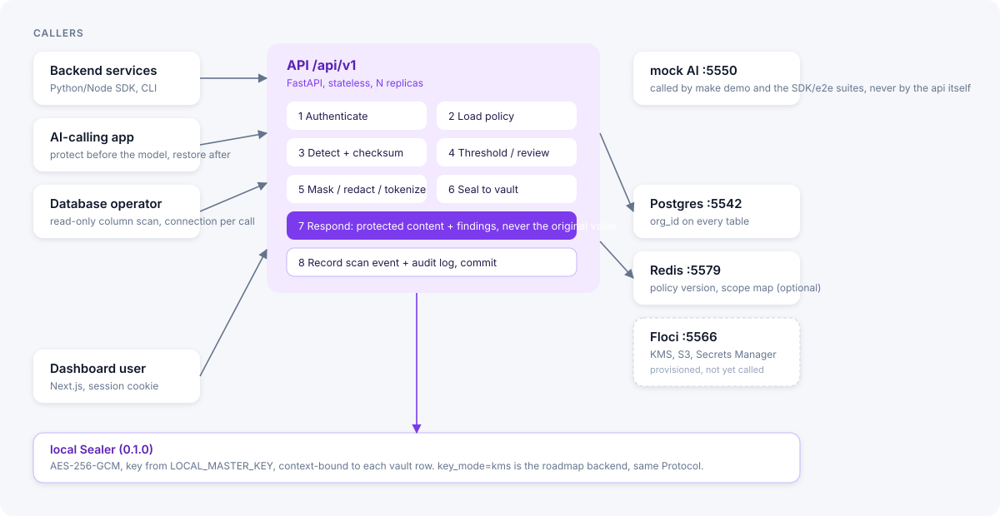

# High-level design

Euron Open PIIShield is a self-hosted detection and protection layer for personally
identifiable and financial information. It sits in front of the places a developer would
otherwise paste or log raw sensitive data: a support tool, a log aggregator, a staging
database seed, or an external AI model. One API handles text, JSON, documents (PDF, DOCX,
XLSX, CSV) and AI prompts and responses, running every value through the same validated
detectors, the same project policy, and the same four protection methods (full mask,
partial mask, redact, tokenize). Reversible tokenization keeps the original value in an
encrypted vault, never in the response, so an authorized caller can restore it later
without the AI provider or log store ever having seen it.

## Goals and non-goals (0.1.0)

| Goals | Non-goals |
| --- | --- |
| Validated, checksummed detection (Luhn, Verhoeff, ISO 7064 mod 97, the PAN entity rule) so a digit string that fails its checksum is never reported as that category | Full NER-based name or address detection (0.1.0 is pattern and dictionary assisted) |
| One API surface for text, JSON, documents and an AI prompt/response gateway | Image OCR or scanned-PDF redaction (needs an OCR dependency this program avoids by default) |
| Reversible tokenization with the mapping held only in an encrypted vault, gated by its own permission | Database write-back anonymization (0.1.0's database scan is read-only, column-level, advisory) |
| A policy that can force a category to be masked, refusing an unmasked protect call for it | Enterprise RBAC/compliance reporting beyond what 0.1.0 needs for its own multi-tenant safety |
| Structural multi-tenant isolation (`org_id` on every table, through a scoped repository) | A hosted SaaS offering |
| An audit log that records what happened without ever recording a real value | KMS-backed key sealing (the `Sealer` protocol ships one backend, `local`, in 0.1.0; see [ADR-0001](adr/0001-envelope-encryption-local-key-only.md)) |

## Context: who talks to what

| Actor | Talks to | How |
| --- | --- | --- |
| A developer's backend service | `api` | `POST /api/v1/protect/text`, `/protect/json`, `/documents/protect`, `/detectors/scan`, through the Python or Node SDK, the CLI, or plain HTTP with a project API key |
| An AI-calling application | `api` | `POST /api/v1/ai-gateway/protect` before the call to an external model, `POST /api/v1/ai-gateway/restore` after, using the `scope_id` the protect call returned |
| A human with vault access | `web`, `api` | Signs in, opens Token Vault, calls `POST /api/v1/vault/detokenize` (own permission, see [security.md](security.md)) |
| An organization owner | `web`, `api` | Projects, policies, API keys, custom recognizers, vault access grants (`POST /api/v1/vault/grants`) |
| Automation (CI, scripts) | `api` | Project API keys (`pii_<prefix>_<secret>`), scope `read` or `write` |
| A database operator | `api`, `web` | `POST /api/v1/database-scan` with a connection string supplied per call, never persisted |
| An external model provider | nothing from PIIShield directly | Only ever sees the protected prompt text; `scope_id` and the vault are never sent to it (see [threat-model.md](threat-model.md)) |

## Containers

| Container | Port (local) | What it does | Where |
| --- | --- | --- | --- |
| `web` | 5510 | Next.js 15 dashboard: sign in, Overview, Scan Center, Detection categories, Policies, Token Vault, Review Queue, AI Gateway, Database Scan, Audit Logs, Reports, Settings | `apps/web/` |
| `api` | 5530 | FastAPI. Everything under `/api/v1`, `piishield openapi`, `/healthz`, `/readyz`, `/metrics` | `apps/api/src/piishield/`, `piishield serve` |
| `mock AI` | 5550 | A deterministic stand-in upstream model, used by `make demo` and the SDK/e2e suites so a protect/restore round trip can be exercised without a real provider; never called by the api itself at request time | `apps/api/src/mockai/` (test and demo fixture, never deployed to AWS) |
| `postgres` | 5542 | Everything durable | RDS PostgreSQL on AWS |
| `redis` | 5579 | Policy cache version stamps, the tokenization scope map, dashboard aggregate response cache | ElastiCache on AWS |
| `floci` | 5566 | Local AWS emulator (KMS, S3, Secrets Manager, SES), provisioned by the same Terraform modules that build production | real AWS |
| `mailpit` | 5525 | Local mail capture | SES on AWS |

One Python source tree builds the `api` image (and `migrate`, `create-admin`, `seed-demo`
from the same package via the `piishield` CLI); the web app has its own image.

## Detection categories

Every finding carries exactly one of five coarse categories (`contact`, `credential`,
`financial`, `government_id`, `personal`). These are what a policy's `required_categories`
and `masking_method` are keyed on, and what the audit log and vault entries record. A
finding also carries a `recognizer` field, the specific pattern that matched (`email`,
`pan`, `credit_card`, `aadhaar`, `jwt`, and so on, see
[detectors/recognizers.py](../../apps/api/src/piishield/detectors/recognizers.py)). The
wire format, the SDKs and the policy engine only ever reason about the five categories;
`recognizer` is metadata for a human reading a finding, not a dimension anything branches
on. This distinction matters because a policy that marks `financial` as required protects
every financial recognizer (card, IBAN, bank account, UPI, SWIFT/BIC, IFSC) with one
setting, without naming each one.

## Request lifecycle (text, JSON, AI prompt)

The same six steps run whether the caller hit `/protect/text`, `/protect/json`, a document
processor's per-leaf callback, or the AI gateway's `protect`:

1. **Authenticate** the project API key or dashboard session; load the project's policy
   (required categories, masking method per category, confidence threshold) from the
   policy snapshot cache.
2. **Detect**: run every enabled recognizer (the built-in table plus the project's custom
   patterns) over the input; validate checksums where one applies; attach a confidence
   score per finding. Overlapping lower-priority matches are suppressed (see
   [LLD.md](LLD.md)).
3. **Threshold**: a finding below the policy's confidence threshold is queued to the
   review queue instead of being auto-protected, unless its category is marked required
   (then it is protected regardless, per acceptance criterion 10, and still flagged for
   review per criterion 13).
4. **Protect**: apply the requested or policy-default method per category (full mask,
   partial mask, redaction, or tokenization, reserving a vault row and a scope-consistent
   placeholder for tokenize).
5. **Respond**: return the protected content, the finding list (category, span,
   confidence, checksum result, method, placeholder when tokenized; never the original
   value for a redacted or tokenized finding), and, for `/protect/text`, `/protect/json`
   and the AI gateway's `protect`, a `scope_id` the same caller can use again for scope
   consistency (AC4) or, for the AI gateway, submit later to `restore`.
6. **Record**: a scan event (counts and categories only) and an audit log entry (same
   shape) are written and committed in the same transaction as the protection itself.

Document protection (`/documents/protect`) reuses this exact pipeline per text leaf (a PDF
page, a DOCX paragraph, a spreadsheet cell) rather than re-implementing detection or
protection; see [LLD.md](LLD.md)'s documents section.

## Caching and query layers

| Layer | What | Where | Key | TTL / invalidation |
| --- | --- | --- | --- | --- |
| Project policy | Required categories, masking method per category, confidence threshold, retention | In-process TTL cache (default 5s, `policy_cache_ttl_s`) read-checked against a version stamp in the KV backend | `piishield:policy_version:<project_id>` | Any admin write bumps the version via `KV.incr`; every replica's next read sees the bump and refreshes, even without a pub/sub channel. A deliberately bounded staleness window, not instant invalidation; see [ADR-0002](adr/0002-bounded-staleness-policy-cache.md) |
| Tokenization scope map | value fingerprint to placeholder, for an in-flight scope | KV (Redis, or in-process memory without Redis), 1 hour TTL | `piishield:tokenize:<org>:<project>:<scope_id>:<fingerprint>` | Expires with the TTL; the durable record is the `vault_entries` table, so a cache miss or a KV outage never breaks scope consistency, only the fast path (see [security.md](security.md)) |
| Detection regex/checksum tables | Compiled recognizer patterns, built-in and per-project custom | In-process, compiled once at import/startup | n/a | Process restart only; 0.1.0 has no hot-reload of a newly added custom pattern for processes already running |
| Dashboard aggregates | Scan counts, findings by category, pending-review counts | Live Postgres aggregate query plus a short KV response cache | query params | Computed on each cache miss (reports/service.py); no separate rollup table or worker |
| Dashboard | Server state | TanStack Query | per resource | `staleTime` per view, invalidated on mutation |

The KV abstraction (`core/kv.py`) is a `Protocol` with two implementations, `RedisKV` and
`MemoryKV`: PIIShield is designed to degrade predictably rather than fail closed when
Redis is absent or down, because it is a detection/protection tool, not a budget enforcer.
Without `REDIS_URL` set, every one of the caches above still works correctly for a single
replica; with it, state is shared cluster-wide. See `scripts/test-matrix.sh`, which runs
the full integration suite under both.

## Multi-tenancy

Every table carries `org_id` (`OrgScoped` mixin), and every query goes through a scope
object (`OrgScope`) carrying the caller's `org_id`, never a bare filter added per route.
A project, policy, vault entry, custom recognizer, scan record or audit row that belongs
to another organization is unreachable: a lookup by id that does not match the caller's
scope returns 404, never 403 and never a hint that the row exists (acceptance criterion
12). This is structural, the same pattern the program's other projects use: a new route
cannot forget the scope check because the repository functions require an `OrgScope`
argument to run any query at all.

## Where to read next

- [LLD.md](LLD.md): the domain-by-domain code walk, key functions and signatures.
- [data-model.md](data-model.md): every table, column and what is deliberately never
  stored.
- [security.md](security.md): envelope encryption, vault access, auth, the audit log's
  no-raw-value guarantee, boot guards.
- [threat-model.md](threat-model.md): assets, threats, mitigations, accepted risks.
- [adr/](adr/): the decisions worth a newcomer's question.
