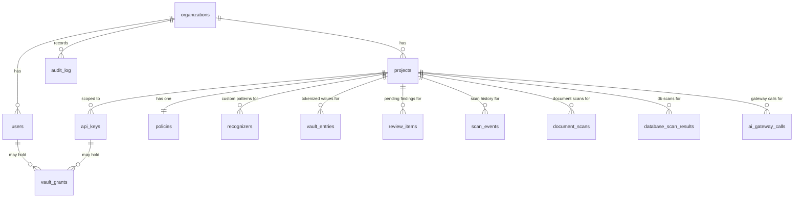

# Data model

PostgreSQL 16. The schema is owned by Alembic
(`apps/api/src/piishield/migrations/versions/`); SQLAlchemy models live in each domain's
`models.py`. Every table except `organizations` carries `org_id` through the `OrgScoped`
mixin, and every repository query takes an `OrgScope` built from the caller's `org_id`, so
tenant isolation is structural rather than a per-route filter (acceptance criterion 12).

## Organization and identity

| Table | Purpose | Notable columns |
| --- | --- | --- |
| `organizations` | The tenant boundary | `id`, `name`, `slug` unique |
| `users` | People who sign in to the dashboard | `email` unique, `password_hash`, `role` (`owner`/`admin`/`viewer`, ranked `ROLE_RANK = {viewer:0, admin:1, owner:2}`), `vault_access` boolean (independent of `role`, acceptance criterion 5), `disabled`, `session_version` (bumped on password change to end existing sessions immediately), `last_seen_at` |
| `api_keys` | Project-scoped management/automation credentials | `project_id`, `name`, `prefix` unique (12 hex chars, the lookup key), `secret_hash` (peppered HMAC-SHA256, the secret itself is never stored), `scope` (`read` or `write`; a key never implies vault access, that is its own grant), `revoked_at`, `last_used_at` |
| `projects` | The scoping boundary for keys, policies, custom recognizers, vault entries and scan history inside one organization | `name`, `slug` unique per org (`uq_projects_org_slug`), `description` |

## Policy and detection configuration

| Table | Purpose | Notable columns |
| --- | --- | --- |
| `policies` | Per-project settings: one row per project (`unique` on `project_id`) | `required_categories` (JSONB list of the five coarse categories that must always be protected regardless of confidence, acceptance criteria 10 and 13), `masking_method` (JSONB `category -> "full_mask"\|"partial_mask"\|"redact"\|"tokenize"`, categories absent default to `tokenize`), `partial_mask_reveal` (characters revealed from the end), `confidence_threshold` (float, default `0.6`), `retention_days` (default `90`) |
| `recognizers` (`CustomRecognizer`) | Per-project custom pattern recognizers | `project_id`, `name`, `category`, `pattern` (a regex, compiled and cached by the service layer; an invalid pattern is rejected at creation as a 422, never stored broken), `confidence`, `enabled` |

## The vault

| Table | Purpose | Notable columns |
| --- | --- | --- |
| `vault_entries` | The only place an original value is ever recoverable from a placeholder; one row per tokenized value | `project_id`, `scope_id` (a request id or a named session, the boundary within which a value always maps to the same placeholder, acceptance criterion 4), `category`, `placeholder` (e.g. `[EMAIL_001]`), `sealed_value` (AES-256-GCM ciphertext, base64, sealed under this row's own `id` as AEAD context, see [security.md](security.md)), `value_fingerprint` (HMAC-SHA256 of the plaintext under a fixed, non-secret context label: lets a repeat `tokenize()` call find its existing placeholder without ever decrypting anything), `expires_at`. Unique constraint `(org_id, scope_id, placeholder)` |
| `vault_grants` | The vault-access permission, separate from role and from API key scope (acceptance criterion 5) | Exactly one of `user_id` or `api_key_id` is set, `granted_by`, `revoked_at` |

The plaintext of a vault entry exists nowhere else once the row is written: not in
`scan_events`, not in `review_items`, not in `audit_log`, not in any HTTP response other
than an authorized `POST /api/v1/vault/detokenize` call.

## Scan, document and database-scan records (never a value)

| Table | Purpose | Notable columns |
| --- | --- | --- |
| `scan_events` | Append-only record of every text/JSON/document/AI-gateway scan | `project_id`, `source` (`text`/`json`/`document`/`ai_gateway_protect`/`ai_gateway_restore`), `finding_count`, `review_count`, `categories` (JSONB list of coarse categories; never a recognizer name tied to a specific matched value, and never the value itself) |
| `review_items` | Low-confidence findings pending a human decision (acceptance criterion 13) | `project_id`, `category`, `start`, `end` (the span, not the text at that span), `confidence`, `recognizer`, `already_protected` (true when the category was also `required`, so it was protected anyway per AC10 but still queued for review), `status` (`pending`/`approved`/`dismissed`), `decided_at`, `decided_by` |
| `document_scans` | One row per document protect call | `filename`, `file_type` (`pdf`/`docx`/`xlsx`/`csv`), `finding_count`, `categories`, `breakdown` (JSONB, e.g. `[{"page": 1, "finding_count": 3, "categories": [...]}]` or `[{"sheet": "Sheet1", ...}]`). The document's bytes are never persisted; a document scan is request-scoped like text and JSON |
| `database_scan_results` | Read-only, column-level advisory scan results | `table_name`, `rows_sampled`, `columns` (JSONB, e.g. `[{"column": "email", "category": "contact", "confidence": 0.9, "sample_hits": 8}]`). The connection string and credentials supplied for the scan are never persisted, only the findings |
| `ai_gateway_calls` | Counts only, per AI gateway call | `project_id`, `scope_id`, `stage` (`protect`/`restore`), `finding_count`, `categories`. Never the prompt or response text |

## Audit

| Table | Purpose | Notable columns |
| --- | --- | --- |
| `audit_log` | Append-only; the only writer is `audit.service.record` | `seq` (per-organization monotonic sequence, assigned by a scalar subquery so concurrent writers from one org still get a consistent order), `created_at`, `actor_kind` (`user`/`api_key`/`system`), `actor_id`, `actor_label`, `action` (e.g. `scan`, `tokenize`, `detokenize`, `policy.updated`, `review.approved`, `ai_gateway.protect`), `project_id`, `finding_count`, `categories`, `details` (JSONB, passed through `_sanitize_details`, which drops any key named `value`, `original_value`, `plaintext`, `raw`, `text`, `content`, `password`, `secret`, `secret_hash`, `token`, `api_key` or `ciphertext`) |

`list_entries` (the only reader) caps `limit` at 200 regardless of what is requested, and
the API's `next_cursor` is always `null` in 0.1.0; there is no cursor-based pagination
past that cap yet. This is a known 0.1.0 limitation, documented in
[security.md](security.md), not a bug.

## What is deliberately never stored, anywhere

- The plaintext of a tokenized value, outside `vault_entries.sealed_value` (encrypted).
- The matched text of any finding, in `scan_events`, `review_items`, `document_scans`,
  `database_scan_results`, `ai_gateway_calls` or `audit_log`. Every one of those tables
  stores only counts, categories, spans (offsets, not substrings) and confidence.
- Document bytes (PDF/DOCX/XLSX/CSV uploads are processed and returned in the same
  request; nothing is written to disk or to the database).
- AI gateway prompt or response text.
- A database scan's connection string or credentials (supplied per call only).
- The plaintext secret half of an API key (only its peppered HMAC, `secret_hash`).

## Indexes and constraints

Every table that is looked up or listed per-project carries an index on `project_id`
(`api_keys`, `recognizers`, `vault_entries`, `review_items`, `document_scans`,
`database_scan_results`, `ai_gateway_calls`). `vault_entries` additionally indexes
`scope_id` and `value_fingerprint` (the two lookup paths `vault.service.tokenize` uses) and
enforces `(org_id, scope_id, placeholder)` as unique so two values can never collide on the
same placeholder within a scope (acceptance criterion 4). `api_keys.prefix` is unique and
indexed (the only column an API key is looked up by before HMAC verification).
`audit_log.action` and `audit_log.created_at` are indexed for the dashboard's filtered
views. `policies.project_id` and `database_scan_results` style foreign keys to `projects`
cascade on delete, so removing a project removes everything scoped to it.
